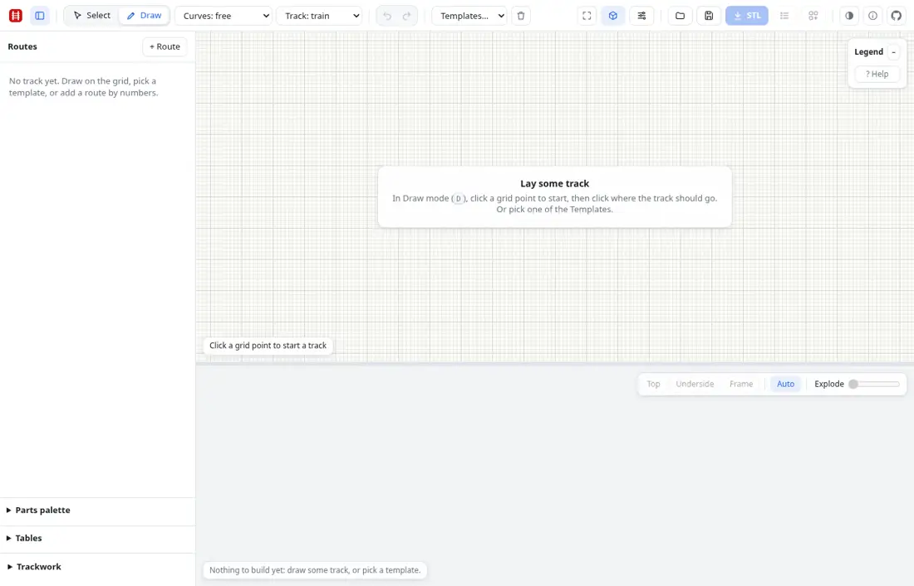
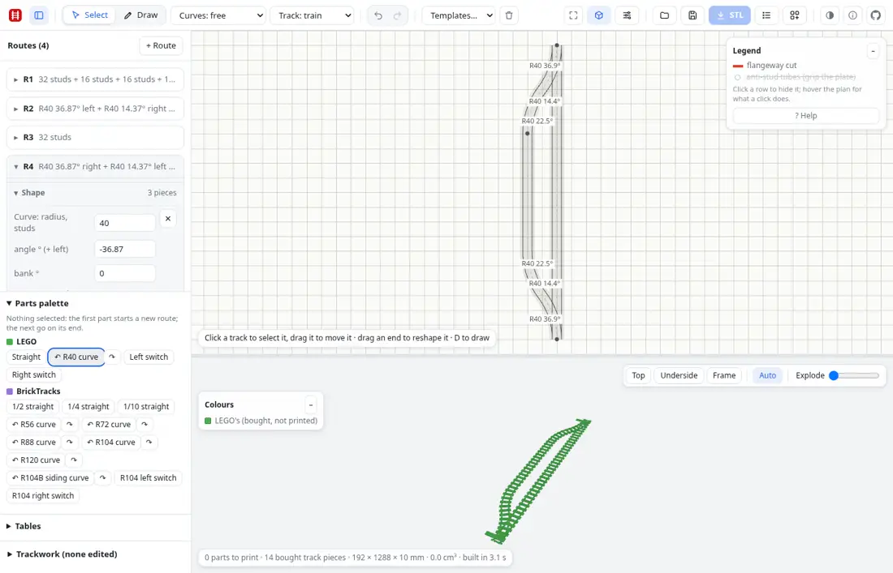
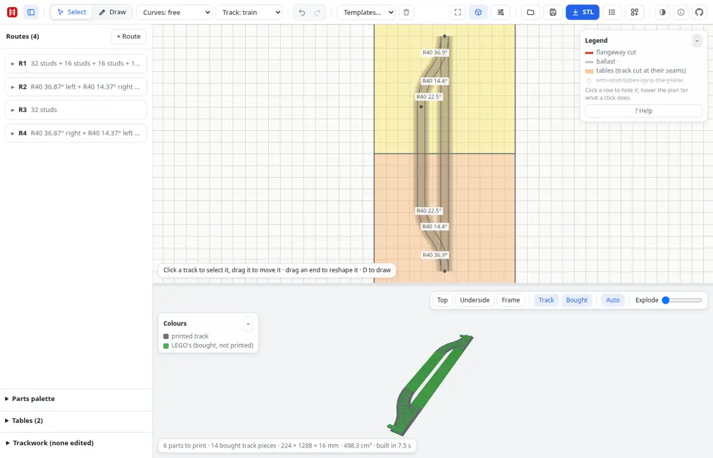
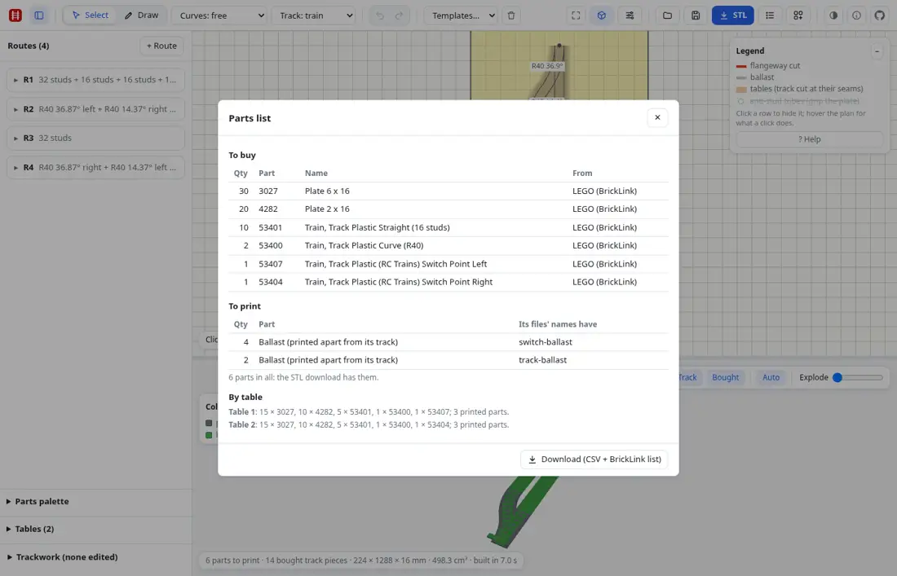
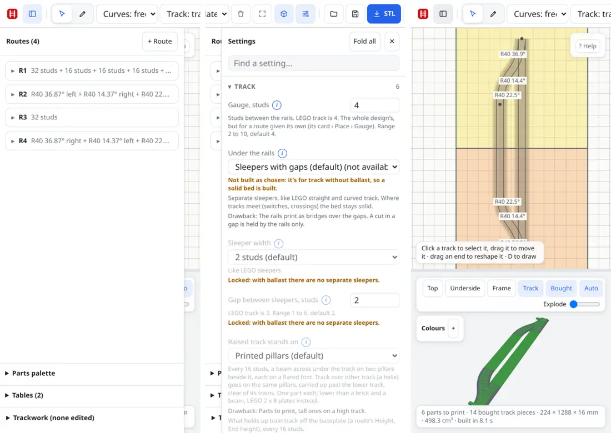
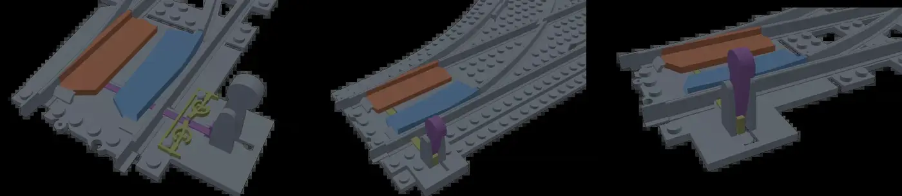
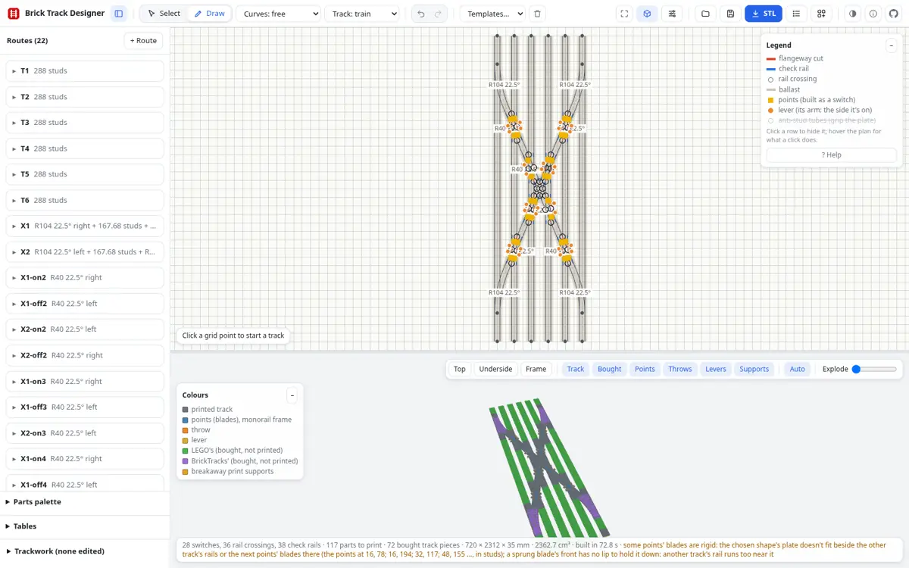

# Brick Track Designer: evaluation, November 2026

Evaluated at commit `0cfeed2` (main, 10 Nov 2026). Written for Aaron. This judges the whole app against what it is
for. Nothing was fixed. Work in flight (mixed gauge part 2; cut fixes; crossovers that run off a track's end) is
mentioned, not judged.

## Verdict

**The software is ahead of the evidence.** As a design tool it does what it was started for: it draws and builds
trackwork the old generator could not (an X yard with 28 switches builds in about 75 s in the browser; a switch in
2 s), it knows bought track, tables, ballast, and it has 132 templates and 83 documented settings. The checking in
code is unusually thorough.

But the end test is printed parts that go together, hold their points and let LEGO wheels through, and **nothing in
the switch mechanism has been printed since it was last changed** (snap clamp, shallow slider, thin sprung plates,
flange relief, pin relief). Every mechanical goal below is therefore "partly met" at best. More features will not
change that; test prints will.

Score: **11 met, 17 partly met, 1 missing** (29 goals).

## Top five for the roadmap

| # | What | Size | Needs Aaron? |
|---|---|---|---|
| 1 | **A test-print kit and one round of prints.** A small set of coupons and one real switch, printed, measured, and the defaults tuned from the results. | small to build, then waits on prints | **Yes**: print, try with real wheels, report |
| 2 | **Throws that fit BrickTracks' throw modules.** Not started. It was a stated requirement. | medium | **Yes**: underside photos and a few measurements first |
| 3 | **Make the output usable by someone who wasn't there.** A README in the STL zip (what each file is, how many, which way up, assembly order, material), a name asked for before download, text labels on the toolbar, a palette that can attach a switch by any of its ends. | medium | No |
| 4 | **Guard the speed that was won.** The time budgets in the tests are 4 to 7 times what the builds take, so a build that got three times slower would pass. Tighten them, record timings per commit, and measure the 3D view's frame rate on a real graphics card. | small | No |
| 5 | **Close the coverage holes that matter for a layout**, in this order: the "monster crossover" itself as a template (it was the reason for the app); dual-gauge and narrow-gauge points beyond R40/one blade; the monorail switch out of "experimental"; the reference parts still missing (listed below). | large | Decisions on which parts he actually wants |

What needs Aaron himself, in one place: the test prints (item 1); BrickTracks throw photos (item 2); a decision on
whether LEGO straights on ballast should sit on LEGO plates (30 large plates for 10 straights in my test) or on
printed ballast; a decision to drop options the app itself says don't work (the over-centre spring); which of the
missing reference parts he wants.

## Scorecard

Goals marked *(inferred)* are my reading, not his words.

| # | Goal | Score | Evidence | "Met" would need |
|---|---|---|---|---|
| | **Purpose** | | | |
| 1 | Complex trackwork (crossings, slips, switch fields) can be drawn and built, with a 3D preview | **Met** | X yard: 28 switches, 117 printed parts, built in 73 s in the browser. Double slip 8 s. | |
| 2 | STL export of parts cut for the print bed | **Met** | Zip of 6 STLs for my passing loop in 0.1 s; `stl-file.test.ts` reads each file as a slicer does. 3MF was planned, then removed. | |
| 3 | Better than the old generator, not a copy of its quirks; old generator stays the reference for single pieces | **Met** | PHASE3.md lists faults found and fixed that the old one still has; parity tests kept (`switch-parity`, `parity/`). | |
| | **Coverage of parts** | | | |
| 4 | A template for every trackwork part in the reference makers' ranges | **Partly** | 97 reference templates. Missing parts listed in the detail section. No monster crossover template. | The missing list worked off, or struck out by Aaron |
| 5 | Reference parts copied exactly first; deviations are options with drawbacks noted | **Partly** | Every choice in Settings has a "Drawback" line. But no test compares a template to a reference STL or measured drawing: "exact" rests on the route numbers. | A check of a few templates against the reference STLs on disk |
| 6 | LEGO's and BrickTracks' own track known as bought pieces | **Met** | Palette: 4 LEGO and 12 BrickTracks pieces; `bought-switches.test.ts`, `palette.test.ts`. | |
| 7 | Monorail, narrow gauge, dual gauge, mixed gauges | **Partly** | All exist. Monorail switch and level crossing say "experimental". Dual gauge through points at R40 only. Points between different gauges are not built. Mixed gauge part 2 is in flight. | Experimental labels gone; print of one monorail joint |
| | **Generation quality and printability** | | | |
| 8 | Parts print without slicer supports; pins lie along layers; slots stop short of edges | **Partly** | Tests prove each file lies on the bed, is one solid, fits the bed. Overhang and floating-island checks are scripts run by hand (`scripts/overhangs.mts`, `islands.mts`), not CI. Never sliced or printed since the changes. | Overhang check in CI; a sliced sample |
| 9 | Cuts and seams never pass through a stud; parts fit the bed | **Met** | `studs.test.ts`, the assembled checks' "fits the print bed". "Studs a cut goes through" defaults to none. | |
| 10 | The parts can actually be assembled | **Partly** | Seven checks on every template (`assembled.shared.ts`): no overlap, moving parts travel, each goes in, joints draw apart, files print. Its own header says what isn't checked: going down onto a baseplate's studs; axle joints lining up. Not printed. | Those two checks; a printed switch put together |
| 11 | Undersides grip a baseplate, not too hard, on the stud grid by default | **Partly** | `underside-grid`, `underside-ends`, `underside-throw`, `grip-*` tests. How hard it grips is a printer question: the fit numbers (0.18, 0.06 mm) are from one straight printed in October. | Grip coupon printed on his printer |
| 12 | Banked curves ease in and out gently | **Partly** | `bank.test.ts` (8 tests); settings for ramp length and "steepest climb, 1 in N". The failure this fixes was found by printing; the fix has not been printed. | One banked curve printed and run |
| 13 | LEGO wheels get through | **Partly** | `flange-clearance.test.ts` sweeps a flange (from LDraw wheel sizes) through the points. Two tests; calculated only. | A wheelset rolled through a printed switch and crossing |
| | **Mechanism** | | | |
| 14 | Points hold their setting and let a train trail through | **Partly** | Default is "Lever click", whose own help says a trailing train can derail. The snap clamp is worked out at about 0.25 N, "a print 0.2 mm out changes that by a fifth". Not printed. The over-centre spring is still offered though its help says it does not hold. | Prints; then pick the default from what works |
| 15 | Throws compatible with BrickTracks' throw modules | **Missing** | No setting, no code. Waiting on underside photos. | Photos, then the interface |
| 16 | Double slip throws are possible (outside, as the reference) | **Partly** | Both double slip templates have levers outside and pass the assembled checks. They fall back to rigid blades (a warning says so). Not printed. | A printed double slip |
| | **Bought track and layouts** | | | |
| 17 | Bought track counted like printed: parts list, colours, a toggle | **Met** | My loop: "To buy" table with LEGO part numbers, by table, CSV and BrickLink wanted list; green in 3D; Bought toggle. | |
| 18 | Printed ballast each bought piece sits in, one per piece, with the older shared way as an option | **Partly** | Works for curves and switches ("A part for each piece" default, shared as the other choice). LEGO straights get no printed ballast: they go on LEGO plates, with no setting to change it. Seat fit not printed. | Aaron's decision on straights; a seat printed |
| 19 | Tables, curved ones included; his standard sizes; track cut at their seams | **Met** | Ready-made 30" × 60", 72", 96", modules, corner modules. Parts list splits by table. Nit: a second ready-made table lands exactly on the first. | |
| 20 | Templates of his real layouts (return loops, X yard, yards, helix on stanchions) | **Met** | All four exist and build; `train-supports.test.ts` for the helix. | |
| 21 | A parts palette to place bought pieces | **Partly** | Works and is quick. But a switch can only be laid from its toe: the far switch of a passing loop had to be placed by typing x, y and heading into two route cards. | Lay a part by any end; flip |
| | **UI and settings** | | | |
| 22 | Settings: plain, ranges and defaults shown, greyed with the reason, help and pictures, well organised | **Met** | 83 settings in 15 sections, all with help; 184 pictures; search; `coverage.test.ts` fails if one is left out. See the phone screenshot: "Locked: with ballast there are no separate sleepers". | |
| 23 | Sizes in studs, fits in mm; no forbidden words in the UI or repo | **Met** | Lengths are studs throughout; mm only for fits and the print bed. No hit for the old generator's name in the UI files; no reference maker's brand name in the repo. | |
| 24 | A new user can finish a real task, on a phone too *(inferred)* | **Partly** | I did, in about 25 actions. But: icon-only toolbar; the empty page doesn't mention the palette; files are called "track-piece" until saved; the STL zip has no instructions; long layouts show tiny in 3D. | Roadmap item 3 |
| | **Performance** | | | |
| 25 | Builds are fast; nothing near 500 s; regressions caught | **Partly** | Browser, cold, 16 cores: switch 2.2 s, double slip 7.8 s, double crossover 17 s, yard 25 s, return loop 30 s, X yard 73 s. Good. But the test budgets are loose (X yard 500 s, return loops 350 s). | Budgets at 2× measured; timings logged |
| 26 | Auto off never builds; plan updates stay quick | **Met** | Smoke test ("with Auto off an edit leaves the 3D view to Build"), `plan-only.test.ts`. | |
| 27 | The 3D view is as fast as it can be | **Partly** | One shared material per colour since the X yard work. I could only measure with software rendering (about 1 frame/s on the yard), which says nothing about a real card. No frame-rate test exists. | A number from a real GPU on the X yard |
| | **Tests and CI** | | | |
| 28 | CI catches regressions, never hangs, and gates the live site | **Partly** | Watchdog at 25 min, 10 shards, runs take 10 to 16 min, Pages publishes only the newest green commit. But 17 of the last 59 runs failed and 3 hung (before the watchdog); everything is pushed straight to main. The UI code (2,900 lines) has only the smoke test. | See "Tests and CI" below |
| | **Docs** | | | |
| 29 | README and Help are enough to use the app and print the result | **Partly** | Help covers every feature, accurately. It is one long page of dense paragraphs. Nothing anywhere says how to print (material, orientation, which supports break off) or how to put a switch together. The plan documents describe a different app (React, 3MF). | A printing and assembly guide |

## What I did

- Read README, the plan documents, the Help text and all 387 commit subjects.
- Did one real task in a browser, start to finish: a passing loop with a bought LEGO switch at each end, on two
  30" × 60" tables, ballast and buddy, default 256 mm bed; then the parts list, the STL zip and the layout-parts zip.
  Then the same design at phone size.
- Timed cold builds of six templates in the browser.
- Compared the templates with both reference makers' ranges in the BlueBrick library on disk, and with the old
  generator's files and TODO.
- Read what each assembly and printability test checks, the CI workflows and the last 60 CI runs.

What I did **not** do, so you can weigh this: I did not run the test suites; I did not render and inspect new close-ups
of joints and undersides beyond the settings pictures; I did not read the logs of the failed CI runs.

## The task, step by step

1. **Empty page.** It says to draw or pick a template. It does not mention the Parts palette, which is the right tool
   for a layout made of bought track. The toolbar is icons only; I had to hover each to learn it.
2. **Palette: Left switch, then six Straights.** Quick and right: each click adds to the selected route's end. Built in
   2 to 3 s. Good.
3. **The siding.** Selecting the branch route means clicking its card. Clicking an already open card closes and
   deselects it, and the next palette click then starts a stray new route somewhere below. That happened to me once.
4. **The far switch.** There is no way to lay a switch from its heel or its branch end. I laid a Right switch as a new
   route, then typed y = 160 and heading = 180 into both of its route cards. This is the weakest point of the flow: a
   passing loop is the most ordinary thing to build.
5. **Result:** "0 parts to print · 14 bought track pieces", all green in 3D. Correct.

6. **Tables.** Two ready-made 30" × 60" tables. The second lands exactly on top of the first; I moved them by typing
   y. Once moved, the seam is drawn and the parts list splits by table.
7. **Ballast + buddy.** One select in Settings. Rebuilt in 7.5 s: 6 printed parts (each switch's ballast in two, each
   curve's in one). The ten straights go on LEGO plates instead: the list asks for 30 × Plate 6 × 16 and 20 × Plate
   2 × 16. That is a real cost and there is no setting to print that ballast instead.

8. **Downloads.** The parts list is clear and has LEGO part numbers and a BrickLink list. The STL zip is six files
   named `track-piece-switch1-ballast2.stl` and so on: no list, no note on which way up or how they join. The
   layout-parts zip does have a README.
9. **3D view.** The pane is the bottom third of the window and frames a long layout corner to corner, so it is small.
   "Top" does not turn the long side level. The colour key calls printed ballast "printed track".
10. **Undo** is lost on reload (the design is kept).

**Phone (390 × 844).** It works: no sideways page scroll, panels slide over the plan, settings read well. The toolbar
scrolls sideways with no hint that Templates, Save and STL are off-screen. The routes panel is open over the plan on
first load.

## Coverage: what the app can't make

Templates: 132 in six groups (Crossings 5, Switches 7, Layouts 9, Features 10, Monorail 4, Reference trackwork 97).

Covered from the reference ranges: switches R40 to R148 with either lever side, yard and short variants, curved
switches, wyes (plain, mixed radii, 8-stud), three-ways, zero/2/4-stud gap switches and three-ways, crossings 90°,
45°, 22.5°, star, curved R24 to R104, two R120 curves, pass-through crossings, T-junction core, double and single slip
R40, double slip at 22.5°, double crossover R40, 4-stud-gap crossovers, buffer stop, the narrow-gauge switches,
crossings and double crossover, one dual-gauge switch.

Not there (trackwork only; plain curves and straights are left out on purpose, since any radius can be drawn):

- **The monster crossover and its double-slip variants** as a template. The X yard is close kin, but the part that
  started the project is not in the list.
- The R40 **perpendicular** switch; the dome and double-dome crossings; the W-junction;
  the full T-junction sets (only the core).
- Dual gauge: the **gauge-transfer slide** pieces; dual-gauge **turnouts** (one gauge leaving the other); dual-gauge
  curves with the third rail inside, outside or centred as named parts.
- The modular R104 system as modules: base, detachable ends, middle section, double-slip adapters, track terminator.
  The app builds the assembled result, not the same kit of sections.
- The first reference maker's modular R40 switch kit (split track, diverger, adapters) and its **triple crossover**
  component; its monorail extras (cross switch, diagonal straights, ramp extensions).
- Accessories: decoupler, bridge head and section, switch motor mounts, the road crossings.
- From LEGO's own range: nothing missing that is in current production; the old 9V crossing and flex track are not
  bought pieces.
- From the old generator: the rail holder (`holder.scad`) and single rail have no counterpart. 3MF with a colour per
  part was on its wish list and was removed here.
- Not built at all: **points between two gauges**; dual gauge through points other than R40; **BrickTracks-compatible
  throws**.

## Generation quality: proven, calculated, unprinted

**Proven by test, on every template:** parts don't overlap; blades, sliders and levers move through their travel
without touching anything; each moving part can be put in the way it is meant to go; joined parts can be drawn apart
in a straight line; every file is one closed solid, lies on the bed and fits it; names are unique; no cut through a
stud; undersides clear every baseplate stud.

**Calculated only:** the snap clamp's holding force; the sprung blades' stiffness; flange clearance (from LDraw wheel
sizes); the bank ramp's climb; stud and anti-stud fits; the bought switch's seat.

**Known loose ends in the code's own words:** edges shared by more than two triangles are tolerated per template up
to a recorded count (X yard 472); several templates fall back from sprung to rigid blades with a warning; the X yard
has a named exception for one lever; the 22.5° double slip's nail-switch variant has springs "in each other's parts".

**Needs a physical print before anyone relies on it:** all of the mechanism (points, slider, lever, snap clamp,
flange relief, pin relief, thin sprung plates at an angle to the grid), the cut joints (tongues, peg and clip, comb
cuts), the underside grip, the ballast seats for bought track, the helix pillars under load, a banked curve.

The mechanism has a lot of choices now: 2 mechanisms × 3 blade shapes × 4 throws × 3 ways to hold the points × 2
hold-downs, plus one or two blades and one or two levers on three-ways. Each was added for a reason, but none has been
ranked by a print. One of them (the over-centre spring) says in its own help that it does not work. This is the
largest risk in the project: effort keeps going into variants of an untested mechanism.

## Performance

Cold builds in the browser (dev server, this 16-core machine, niced):

| Design | Built in |
|---|---|
| Left switch (LEGO), printed | 2.2 s |
| My passing loop, bought, ballast + buddy | 7.5 s |
| Double slip (22.5°) | 7.8 s |
| Double crossover (R56) | 17 s |
| Yard (R56) | 25 s |
| Helix (R104, two turns) | 15 s |
| Double-track return loop (turning right) | 30 s |
| X yard (6 tracks, single slips) | 73 s |

- These are good, and far from the 500 s that was called unacceptable. A rebuild after no change is checked to be
  near-instant.
- The guard is weak. `templates.shared.ts` allows the X yard 500 s and the return loops 350 s in one thread on CI.
  The limits were set as "a few times what it takes" so a busy runner doesn't fail, which also means a real threefold
  slowdown passes.
- JS heap: 40 to 160 MB on the smaller designs, 480 to 720 MB with the X yard, the return loop or the helix built (the page was not reloaded between the last two, so some of that may be carried over). The kernel's own memory is watched and bounded (`memory.test.ts`,
  `kernel-guard.test.ts`).
- With 22 routes the route cards and plan stayed responsive in my runs; I did not measure it finely.
- 3D frame rate: not measured on real hardware. Under software rendering the yard turned at about one frame a
  second. Someone should read the frame time on the X yard on Aaron's machine.

## Tests and CI

- 112 test files, about 340 test definitions (many are loops over every template or setting). `coverage.test.ts`
  fails if a template or setting is in no test.
- CI: typecheck, lint, build; tests in 10 shards under a watchdog; a browser smoke test; dependency scan; secret
  scan. 10 to 16 minutes a run. Pages publishes only the newest commit that passed everything.
- **Reliability:** of the last 59 runs, 39 passed, 17 failed, 3 were cancelled after hanging 60 to 90 minutes (all
  three before the watchdog went in on 9 Nov). The failures cluster where several large features were pushed minutes
  apart on 10 Nov. The last 15 runs are green. The deploy gate meant the live site stayed good throughout.
- **Not covered:**
  - `main.ts` (1,674 lines) and `canvas.ts` (1,255 lines): the whole editor. Only the smoke test touches them, and
    it covers: load a template, draw and undo, a dialog, a bad file, Auto off, replacing a design. Not covered: the
    palette, tables, settings panel, trackwork panel, dragging levers and ends, downloads, touch.
  - Overhangs and floating islands as printed (hand-run scripts).
  - Parts going down onto baseplate studs; axle joints (the assembled checks say so themselves).
  - Frame rate. Phone layout.
  - Anything against a real reference part's mesh.

## Docs and help

- README: short and current. Says what the app is and how to run it.
- Help: complete and accurate, in the app's plain style. It is long and has no pictures; a first-time user will not
  read it. There is no "first five minutes" path.
- Settings help: the best documentation in the app. Each setting has its range, default, drawbacks and pictures.
- Layout-parts zip: has a README. The STL zip: nothing.
- PLAN.md and the PHASE files: honest that they are history, but they sit at the top of the repo and describe React
  and 3MF. Move them under `docs/history/`.
- Missing entirely: how to print these parts and put them together.

## Code health, briefly

Risk sits in four files: `switch/base.ts` (2,552 lines, the mechanism), `app/build.ts` (2,191, cutting and the
build), `app/main.ts` (1,674) and `app/canvas.ts` (1,255). The first two are heavily tested; the last two are not.
The panels are redrawn whole on every change, with a patch (`keepingFocus`) to put the keyboard focus back: it works,
but each new field is a chance to break it, and it is why a card's open state and the selection are tangled (step 3
above). `switch/network.ts` (509 lines, lever placement) has no test of its own; it is exercised through the
templates. The cutter's tolerated bad edges are recorded per template rather than removed.

## Biggest gaps and risks, ranked

1. **Unprinted mechanism.** If the sprung plates are too stiff or the clamp too weak, every switch in a layout is
   affected, and the cure may change the geometry that dozens of tests and templates assume. Each week of features
   built on it raises the cost of finding out.
2. **No BrickTracks throw compatibility.** His layouts use bought track; the throw is where printed and bought parts
   meet under the operator's hand. It is the one stated requirement with nothing built.
3. **Joints and fits unprinted.** A layout is hundreds of joints. Tongue, peg-and-clip and comb-cut fits are all
   calculated. One bad tolerance means reprinting everything.
4. **A new user gets files, not a kit.** No instructions with the STLs. For Aaron this is fine; for anyone else it
   stops them at the printer.
5. **Speed has no tight guard.** The 500 s regression was the kind of thing a loose budget lets back in.
6. **The editor has almost no tests,** and it is where the next round of work (palette, tables) will land.
7. **Option growth.** 83 settings is near the limit of what stays "very nicely organised". Options known not to work
   are still offered.

## Roadmap to "done for the tracks"

**First: find out what works (items 1 and 2).**

1. *Test-print kit.* A "Test prints" template group: (a) a stud and anti-stud fit coupon; (b) one joint of each kind,
   two short halves; (c) a short R40 switch with the defaults; (d) the same with the snap clamp; (e) a bought-switch
   ballast half and a curve's; (f) a banked R56 curve; (g) the 45° double slip. With a one-page checklist of what to
   try and report. **Small. Routine to build. Needs Aaron to print and report.**
2. *Tune from the results,* and pick defaults by what held and what trailed. Remove the over-centre spring and any
   option the prints rule out. **Medium. Complex: deserves the most capable model**, since the forces, clearances and
   the knock-on effects in `base.ts` are subtle. Needs Aaron's measurements.
3. *BrickTracks throw interface.* Copy the module's mounting exactly first, as an option under Throw. **Medium.
   Complex: most capable model.** Blocked on Aaron's underside photos and three or four caliper readings.

**Second: make it usable and keep it fast (items 3 and 4).**

4. README in the STL zip (files, counts, orientation, break-off supports, assembly order per switch); ask for a name
   before the first download. **Small. Routine.**
5. Palette: lay a switch by toe, heel or branch end; a flip button; a second ready-made table goes beside the first;
   a card click that doesn't deselect. **Medium. Routine.**
6. Toolbar text labels or a first-run tour; the palette named on the empty page; 3D "Top" turns the long side level.
   **Small. Routine.**
7. Budgets at twice the measured time, per-template timings written to the CI log as a table; a frame-time probe for
   the 3D view. **Small. Routine.**
8. Playwright tests for the palette, tables, settings and downloads (the script I used for this report is the
   outline). Overhang and island checks into CI. **Medium. Routine.**

**Third: coverage (item 5).**

9. Monster crossover template and its double-slip variants. **Small to medium. Routine** if the solver takes it;
   anything it trips on is complex.
10. Points between gauges; dual gauge through points at other radii; dual-gauge turnouts. **Large. Complex: most
    capable model.**
11. Monorail switch and level crossing out of experimental, with a print. **Medium. Complex**, and needs Aaron to
    print.
12. The remaining reference parts (perpendicular switch, dome crossings, W-junction, T-junction
    sets). **Medium. Mostly routine** (route data), after Aaron says which he wants.
13. The assembled checks' two admitted holes: parts onto baseplate studs; axle joints. **Small to medium. Complex**
    (kernel-heavy tests that must stay fast).

**Later, cheap, any time.** Move the plan documents to `docs/history/`. A printing guide page. Split `main.ts` by
panel when the UI tests exist. Work the tolerated bad-edge counts down.

### Which work deserves the most capable model

- **Yes:** mechanism retuning after prints (2); the BrickTracks throw interface (3); points between gauges and
  dual-gauge switches (10); monorail switch (11); new kernel-heavy assembly checks (13); any cutter or solver fault
  that the monster crossover or new templates expose; bad-edge clean-up in the cutter.
- **Routine:** the test-print kit's templates (1); zip README (4); palette and table fixes (5); labels and tour (6);
  budgets and timing logs (7); UI tests (8); templates that are only route data (9, 12); docs moves; splitting
  `main.ts`.

### What I would deliberately not do

- No new mechanism variants, hold-downs or throw styles until a print has ranked the ones there are.
- No 3MF, no layout import, no multi-colour export. STL plus the layout-parts export is enough.
- No rewrite of the UI framework. Test it, then split it.
- No modelling of the reference makers' modular kits section by section: the app's own cutting makes the same
  trackwork in fewer joints.
- No accessories (decoupler, motor mounts, bridges) inside this app. They are single pieces: the old generator's job.
- No further performance work on build time beyond guarding it. It is good enough; the frame rate is the open
  question.
