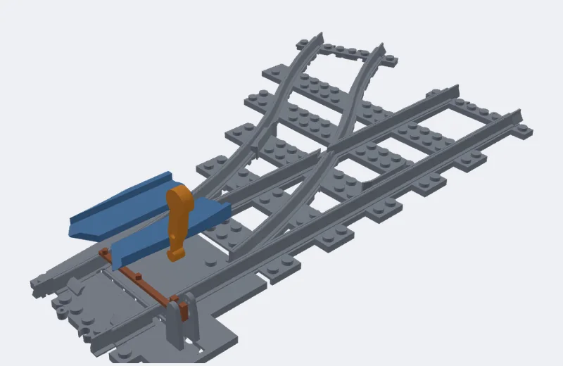
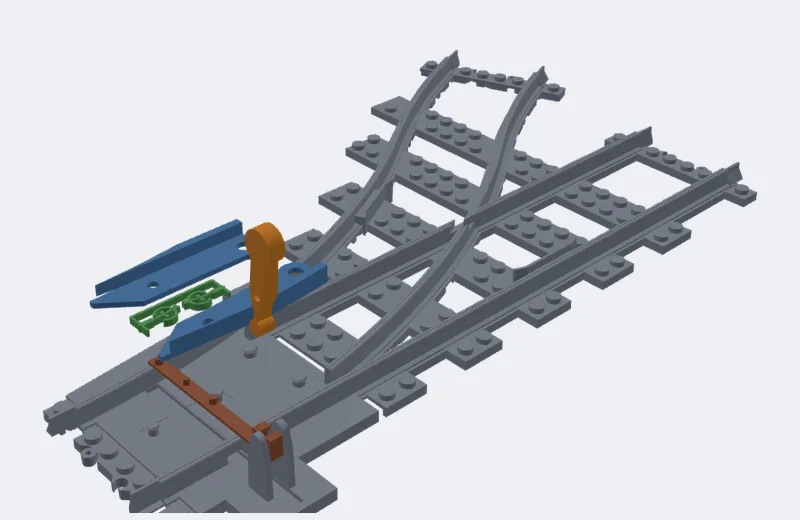
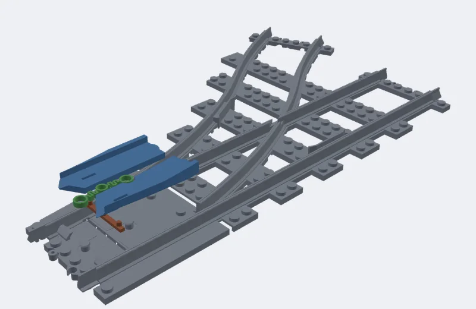
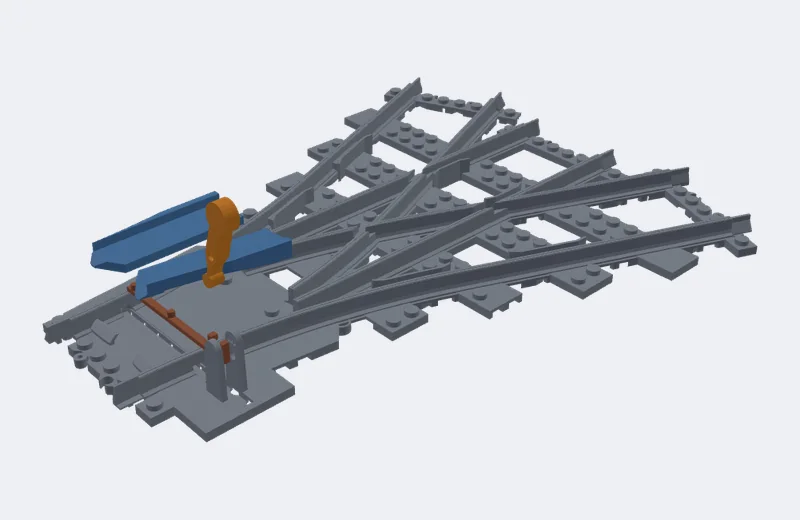
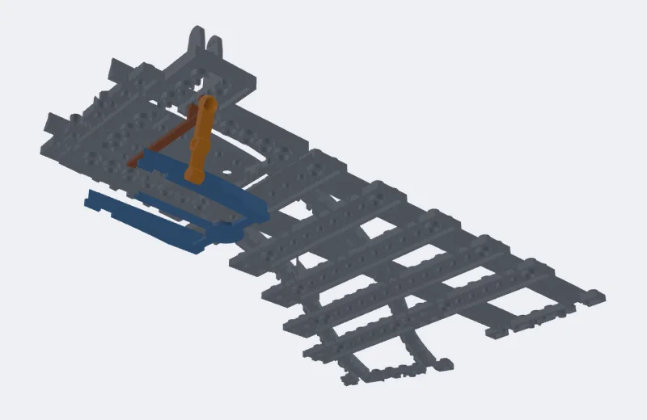
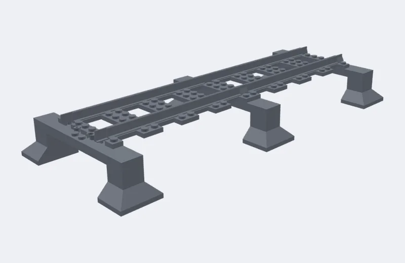

# Printing and assembly

How to print the parts Brick Track Designer makes, and how to put them together. It is for someone who prints and
builds LEGO trains but hasn't read the code. Lengths are in studs (a stud is 8 mm), fits in mm.

**What is and isn't confirmed.** What follows is read from the app's geometry, its own tests and its settings'
help. The tests prove the parts go together on the computer: every moving part goes in, in the way described below,
and moves through its travel without hitting anything. **The mechanism has not been printed since it last changed.**
The fit numbers come from one straight printed in October. Where this guide says something that only a print can
show, it says "not yet confirmed by a test print". [docs/test-prints.md](test-prints.md) is the kit that confirms it.

## What the project assumes

- PLA, or PETG (PETG holds a snap clamp better over the months; PLA slackens). Nothing here says either is best:
  no temperature, speed or cooling is recommended, because none has been tested.
- 0.4 mm nozzle, 0.2 mm layers.
- **No slicer supports, no brim.** Every part is exported lying on the bed the way up it prints: don't turn it.
  The small supports a part needs are built into it (below).
- Your everyday profile otherwise.

## What you get

**STL** (toolbar) downloads the parts to print. One part is a plain `.stl`. Several are a zip, `<name>.zip`, with
one file for each part, `<name>-<part>.stl`, and a `README.txt` that lists every file, which ones carry supports,
and how the points go together. **Parts list** shows what to print and what to buy, and downloads the bought part
as a list plus a BrickLink wanted list.

The files you may meet:

| File | What it is |
|---|---|
| `track…` | Plain track, in pieces cut to fit your print bed (or into LEGO-length pieces, Settings › Print bed and cutting into parts). |
| `…-ballast` | Ballast printed apart from its track, when Settings › Ballast › Track and ballast printed is Apart. Bought track drops into one. |
| `switch-base…` | The track of a switch or crossing, whole, or cut for the bed. Its moving parts are the files below. |
| `…-throw` | The slider that carries the blades over. A longer arm under other track is `…-throw` and `…-throw-posts`. |
| `…-points-a`, `…-points-b` | The two blades (one file for both on tines when Points printed as is One part). |
| `…-spring` | A snap clamp (or, on a nail switch, an over-centre spring). |
| `…-lever`, `…-bracket` | The lever, and the 3 x 3 stud bracket it can stand on. |
| `…-lid` | The lid of an under-the-bed mechanism with Points go in: From above, under a lid. |
| `track-support…` | A pillar or beam under raised track. |
| `monorail…` | Monorail beam pieces and their supports. |

Bought track (LEGO's 16-stud straights, R40 curves and switches; BrickTracks' curves, straights and switches) is
drawn green or purple in the 3D view and is not in the STL download. Settings › Bought track says which pieces are
bought; the parts list names them.

## Printing

### The way up, and what breaks off

Print every file as it comes. Where a part needs support it has some of its own, drawn **gold** in the 3D view (the
Supports button hides them). The zip's `README.txt` marks those files `[has break-out supports]`. Snap them out
with a small screwdriver and check nothing is left in the slots.

| Where | What to take out |
|---|---|
| Under every rail end of a cut part (Settings › Joints › Supports under rail ends, on by default) | A small block under each rail tongue. It snaps off whole, and the tongue's underside has to be flat enough to slide over the next piece's sleeper. In the October prints it came out clean. |
| Under the peg and clip on ballast ends (Peg and clip on ballast ends, when it's on) | Small supports under the peg and the clip. |
| In each sprung blade (`…-points-a`, `…-points-b`, with Blade shape: Sprung, the default) | Small loose pieces in the spring pocket under the plate, 0.2 under its roof, with a slit off the two beams. Break them out: the pocket must be empty end to end, so the plate's spring flexes when you press the blade sideways. *Not yet confirmed by a test print since the plates changed.* |

Nothing else has supports: rigid blades, sliders, levers, brackets, stands and lids print with none. A snap
clamp's **two small links are loose inside it on purpose**: leave them in.

If you'd rather your slicer made the rail-end supports, turn Supports under rail ends off.

### Where the geometry needs care

- **The underside is hollow** (anti-stud tubes that grip a baseplate), so each track part has a roof over the
  hollows, 2 mm up, which prints as a bridge. The project's overhang check
  (`test/printable.*.test.ts`, [what it checks](#what-the-ci-checks-about-printing)) finds roofs wider than the
  10 mm it allows for a bridge in every track part it looks at. *Not yet confirmed by a test print:* watch the first layers over the
  hollows, and use your slicer's bridge settings.
- **Sleepers with gaps** (Settings › Track › Under the rails): the rails print as bridges over the gaps between
  sleepers. Solid bed has none.
- **Studs at cuts:** where a cut passes a stud, the setting Studs a cut goes through decides. *Whole on one part*
  leaves studs standing a little over the joint's edge: printed on the edge, they can snap off.
- **A part that is too long for your bed** is cut to fit (Settings › Print bed and cutting into parts). Enter your
  bed's size there first.

### The fit settings, and the test prints

LEGO studs and tubes need a fit tuned to your printer. Two numbers do it (Settings › LEGO fit):

| Setting | Today | Bigger means |
|---|---|---|
| Stud fit, mm | 0.18 | Studs bigger: bricks grip tighter. |
| Anti-stud fit, mm | 0.06 | Tubes underneath looser: grips the baseplate less. |

The **test prints** (Templates › Test prints) are five small coupons that find them, and check the joints, a
switch and the seat for bought track. [docs/test-prints.md](test-prints.md) says what to print, in what order, how
to put each together, and has the form to fill in. Print them before a whole layout. The first one is five
two-stud straights with 1 to 5 ribs on a sleeper end: the number of ribs that fits your baseplate and bricks
says what to set.

## Putting plain track together

*(Left to right: peg and clip, dovetail, axle holes.)*

1. **Joints.** Parts cut for your print bed, or at a baseplate's edge, join as Settings › Joints › Parts join with
   says:
   - **Rail tongues + peg and clip** (default): like LEGO track ends. Push the two parts together along the track:
     the round peg on one goes into the clip on the other.
   - **Rail tongues + dovetails:** stronger. One half drops down onto the other from above, its tab into the socket.
   - **Straight cuts:** nothing joins them; the baseplate holds them in line.
   - **LEGO axles** (with ballast): a cross-axle hole across each cut. Push a LEGO axle in, half its length in each
     part (Axle length: 2 studs is part 3704, 4 studs is part 3705). Not yet confirmed by a test print: the holes
     lining up across a cut isn't checked by the tests.
   - Plain track cut into LEGO-length pieces (Long track cut into: Track pieces) joins with ordinary end
     connectors, and a bought LEGO straight goes on either end.
2. **Onto the baseplate.** Parts go down onto a baseplate and grip it with their anti-stud tubes (Settings ›
   Underside). Along the edges is the default: firm, and comes off again. Every stud grips very hard. Cut at
   baseplate edges (Print bed and cutting) keeps every part on one baseplate.
3. **Rail tops** should be level across a joint. *Not yet confirmed by a test print.*

### Bought track in printed ballast

With ballast and bought track, you print the ballast and drop LEGO's or BrickTracks' track into its seat (the green
piece above is the bought one). Lay it in; it should drop in and sit flat, with a little slack all round: Settings ›
Bought track and Ballast › Track fit in the seat sets that gap (0.2 mm today). Print **Test print 5** first: it
is one such seat.

### Tables, and seams

Where the layout stands on tables or modules (the Tables panel), track is cut where one table meets the next, so
the parts list can say what goes on each table. Each table's parts join as above; the seam between tables is where
the layout comes apart.

## Putting a switch together

Print every file of the switch (the zip's README.txt lists them), take out the supports (above), join the track
parts of the switch base with the joint you chose, and press them onto a baseplate. Then the moving parts go in
**in this order**, and the order is what the app's assembly tests check part by part: each is tried in the way
described, against the track and against what's already in.

Whichever mechanism, finish the same way: **move the lever (or push the blade): both blades should go over together
and close against their rails.** Then roll a wheelset through every route, both ways, with the points set each way.

### Blades on top (the default)

*(Picture: the parts in the order they go in, from the base up: slider, blades, lever.)*

1. **The slider** (`switch-throw`): down through the opening where the lever will go, then along its tunnel under
   the rails, till its posts stand up where the blades go. (With a two-part slider, under other track, the part with the
   posts goes in from above onto its bar, as the blades do.)
2. **The blades** (`switch-points-a`, `-b`): from above, each onto its pin and onto the slider's post.
   - *Sprung blades* (default) sit on a LEGO stud and have a lip over their front end on the bed: tip the blade
     so its front edge goes in **under the lip first**, then lower it onto its stud.
   - *Rigid blades, Snap lip on the pin:* press down; the hole snaps over a small lip on the pin.
   - *Rigid blades, Lip over the front:* as sprung ones, front under the lip first.
   - *Rigid, realistic:* these tuck under the stock rail's head, so they go on **open** (turned on their pin, the
     slider at its other end) and are then swung closed.
3. **The lever** (`switch-lever`): press it in between its two ears till its pivot clicks in, its foot in the slider.

With sprung blades, a train trailing through the wrong way pushes the blades over and they spring back. With rigid
blades, set the points first. Lever click keeps the points where they are set (Points kept set by: Lever click).

#### Lever on a bracket, or a switch stand

- **Bracket** (Throw: Lever on a bracket): the `…-bracket` is a 3 x 3 stud plate that presses onto the studs on the
  slider's arm; the lever then goes into the bracket's ears as above.
- **Switch stand** (Throw: Switch stand, a ground throw): a handle beside the track that locks at each end. It goes in
  where the lever would, between its ears. It locks, so a train trailing against it derails unless the blades spring back.

*The bracket and stand are put in the same way as the lever in the tests. Not yet confirmed by a test print.*

#### Snap clamp

Points kept set by: Snap clamp. The `…-spring` is one flat part with two small links printed loose in it:

1. Slider, then
2. the clamp, dropped over its two bosses and sprung open over the slider's post: between the blades with rigid
   blades, on the lever's arm (the lever a stud further out) with sprung blades. Don't take the links out.
3. Blades, then lever, as above.

The app's README.txt puts the spring after the slider and before the blades. `docs/test-prints.md` puts it last. The
assembly tests don't try the clamp, so the order is **not confirmed**: whichever lets it drop over its bosses.
The settings help gives its holding force as about 0.25 N, and says a print 0.2 mm out changes that by a fifth. *Not yet
confirmed by a test print.* Print it slowly. Where there is no room for a clamp the lever clicks instead, and the build says where.

#### Nail switch (no lever)

Throw: Nail switch. There is no lever, no arm. The slider stays under the blades, held at each end by an over-centre
spring: slider, then spring (its rings pressed over their pins), then blades. Push a blade over with a fingernail in the notch on its plate.
Trains can trail through. The settings help says the over-centre spring is "worked out, not yet printed", and that it
may not hold: *not yet confirmed by a test print.*

#### Three-way

- **One lever** (the default): one slider under both blades, one lever. Put in the slider, both blades, then the
  lever; it clicks at left, straight and right.
- **Two levers** (Settings › Switches: throw › Three-way switches worked by): each blade has its own slider and
  lever, one each side. Do the steps above once for each blade, left with its lever on the left, right with its lever
  on the right. Both levers thrown at once set no route: a train derails there.

### Under the bed, on spring tines

Mechanism: Under the bed, on spring tines. The moving parts sit in pockets under the bed and go in **from below**,
the lever from above.

- *Points go in: From below* (default). The pockets open through the bottom: fit the points **before** you press
  the track onto the baseplate.
- *From above, under a lid* (needs ballast): a lower layer holds the moving parts, and the deck with the rails clips on
  top with studs. The `…-lid` goes over the points last.

The README.txt order is: throw (slider), spring, points, lever, lid. Points printed as One part has both blades on one
pivot; as Two parts each blade has its own pivot and spring. The spring tines are thin (Spring thickness 0.9 mm):
*not yet confirmed by a test print.*

## Raised track on pillars

A route given a Height (its card › Place) stands on **printed pillars** (Settings › Track › Raised track stands on),
every 16 studs: a beam across under the track, on two pillars beside it, each on a flared foot, one part each. The
beam has a 2 x 2 of studs on top that go up into the track's underside. Print the pillar parts, press their feet
onto the baseplate, and set the track on the beams. The parts print as they stand: the beam is a bridge from pillar
to pillar, the feet slope at 45 degrees. Or choose LEGO bricks: stacks of 2 x 8 bricks and plates, in the parts list.

## Monorail

Monorail pieces (`monorail…`) are beams with ends you choose (Settings › Monorail): hollow studs out of the sides (like
LEGO monorail), two studs on top in recesses, or plain. Each end has two LEGO cross-axle holes (Joining axle length 2 studs
by default) to pin pieces together with axles. A **support** every so many studs (Support every, studs) is a part of its
own: its base grips the baseplate and the beam sits on top. Parts are cut over a supports where they can be. The monorail
points are marked experimental in the app. Printing and assembly are as above: no supports.
*Not yet confirmed by a test print.*

## When it doesn't fit

| What you see | Try (Settings) |
|---|---|
| Track is too hard to press onto the baseplate | Anti-stud fit, mm: **bigger** (0.06 today; the test print's ribs 1 to 5 run 0.16 to -0.04) |
| Track is loose on the baseplate | Anti-stud fit, mm: smaller |
| A brick is too tight on the track's studs | Stud fit, mm: smaller (0.18 today) |
| A brick is loose on the studs | Stud fit, mm: bigger |
| Parts grip the baseplate too hard to pull off | Grip on the baseplate: Along the edges (not Every stud) |
| Bought track too loose or tight in its seat | Track fit in the seat, mm (0.2) |
| Joints won't go together, or are loose | Parts join with: try the other kind; print Test print 2 |
| Rail-end supports leave stubs | Supports under rail ends off, and let your slicer do it |
| Wheels rub in a switch or crossing | Flangeway width and depth, mm (3 and 3); Check rail width, mm (1) |
| A flange touches a sprung blade's plate | Flange relief in sprung blades |
| The open blade's back touches the wheels, or the blades don't close | Blade throw, mm (3), Clearance, mm (0.3) |
| The lever doesn't hold the points | Points kept set by: try Snap clamp; Spring preload, mm (1) |
| A part leaves slots full | Break the supports out again; check the pocket end to end |
| A stud snaps off at a cut | Studs a cut goes through: Taken off |

## What the CI checks about printing

Every change is tested: each part of about twenty representative designs, in the way up it is exported, has no
overhang beyond what the project allows without supports (faces facing down steeper than 45 degrees, unless they are held by the
part's own break-out supports, are a slope of 45 degrees or less, or are a bridge held both sides and 10 mm
or less across), and no floating island (a bit of a layer, 0.2 mm, resting on nothing in the layer below). Where a design fails, the exact part and place is
written down in `test/printable.shared.ts` (`PINNED`) to be fixed, and the test fails if it gets worse. That
is a check of the geometry, not of a print.
